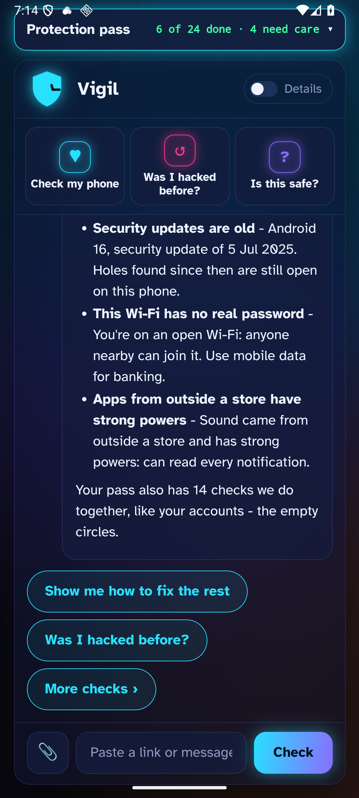

# Virus Vigil

## Security warnings you can actually do something about.

A list of red flags is not much help if you do not know which ones matter or how to fix them. I wanted the explanation and the next step in the same place.

Virus Vigil checks for known malware, suspicious apps and weak security settings. It explains what it found in plain words, and keeps you in charge of changes.

**[See how it works](#what-it-checks) · [Build from source](docs/BUILDING.md) · [Privacy](PRIVACY.md)**

**Release status:** Windows and Android source is public. There is currently **no public APK or Windows installer** in this repository's releases. Do not download a random binary claiming to be an official Virus Vigil release.

*Android development screenshot from a test device. These findings describe that test environment, not your phone.*

## What it checks

| On Windows | On Android |
|---|---|
| Files and folders against known-malware hashes and YARA rules | Installed apps against malware and stalkerware indicators |
| Spy and remote-control software indicators | Files in storage you allow it to read |
| Defender, firewall, SmartScreen and other security settings | Update, network and permission concerns Android exposes |
| Browser security checks and guided fixes | Links to Settings or Android's own uninstall confirmation |

The app also has **Is this safe?** checks and an optional online helper. A detection is something to investigate, not proof that every flagged file or app is malicious.

## How a check works

1. Choose the device or files to check. On Android, grant access after reading the explanation.
2. Let local checks compare fingerprints, pattern rules and device settings.
3. Read the reason beside each finding.
4. Choose the fix yourself. Windows changes require approval and have undo actions. Android opens system controls for you to confirm.

Virus Vigil does not silently delete your files. It helps inspect and improve a device; it does not replace Windows Defender, Android's protections or professional incident response.

## What leaves your device?

**The app does not upload scanned files.** It is not entirely offline:

- Unknown file hashes can be checked with CIRCL hashlookup. A hash identifies a file even though it is not the file's contents.
- Password checks send only the first five characters of a hash to Have I Been Pwned.
- Malware and scam lists are downloaded from their providers.
- The optional helper sends the question you choose to submit to Groq, using a configured key.

Those services receive normal network information such as your IP address. There is no app account, advertising or analytics; I do not run a server collecting your scans. [PRIVACY.md](PRIVACY.md) lists recipients, limits and permissions.

A clean scan means no threat was found in what was checked. It cannot prove a device is safe, catch every unknown attack or rule out false positives. Read the [disclaimer](DISCLAIMER.md).

## How I built it

Rust handles deeper file checks and desktop integration. A web interface runs inside Tauri 2; an Android plugin handles phone-specific checks. Detection inputs and libraries come from multiple sources, with attribution and their own licences in [THIRD-PARTY-NOTICES.md](THIRD-PARTY-NOTICES.md).

The repo includes Rust and browser test suites. Some tests need sample APK fixtures that are intentionally not distributed; [the build guide](docs/BUILDING.md#tests) explains how to supply or regenerate them. Tests are evidence about behaviour, not an independent antivirus certification.

A local build needs Rust, Node.js and the platform tooling in [docs/BUILDING.md](docs/BUILDING.md). The optional online helper has **no included API key**. Do not embed your key in a binary you distribute.

## Help make it less confusing

If a warning is wrong or unclear, [open an issue](https://github.com/Arnav-Agarwal137/virus-vigil/issues) with the message and OS version. Do not upload private files or live malware. A SHA-256 hash or harmless reproduction is enough to start.

Built by [Arnav Agarwal](https://github.com/Arnav-Agarwal137). Independent of Microsoft, Google and the security-data providers it uses.

## Licence

Free noncommercial use and private improvements are permitted for newly licensed original work.
Share the official links freely. Redistributing copies, publishing modified versions, public mirrors,
rebranding, and commercial use require Arnav Agarwal's prior written permission.
Keep authorship and required notices. This is a source-available custom licence, not an open-source licence.
Earlier licence grants and third-party rights remain in force; see [LICENSE-HISTORY.md](LICENSE-HISTORY.md).
Previously published source, embedded app notices, tags and downloadable binaries retain their earlier grants;
this policy does not retroactively prohibit their previously permitted use or distribution.

Full terms: [LICENSE](LICENSE). Permission requests: [GitHub issues](https://github.com/Arnav-Agarwal137/virus-vigil/issues).
